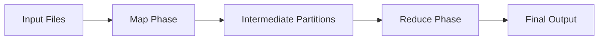
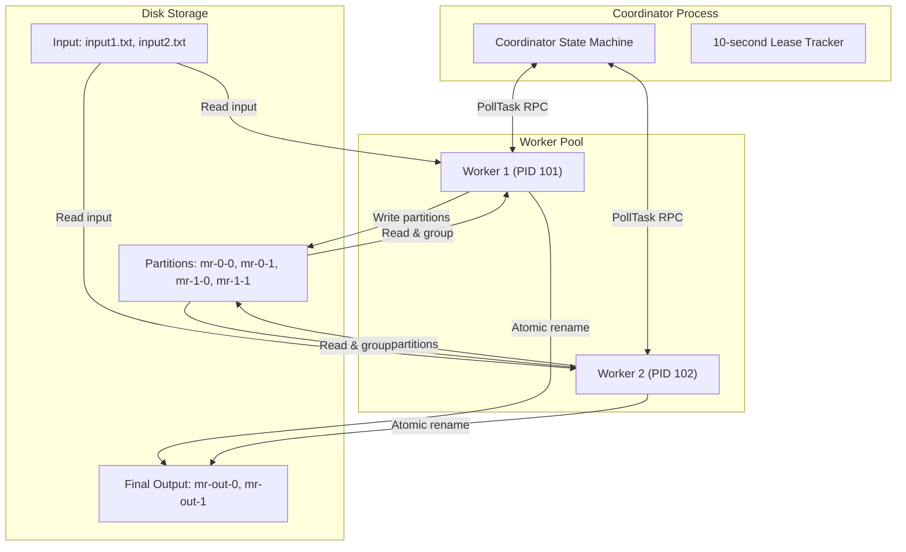
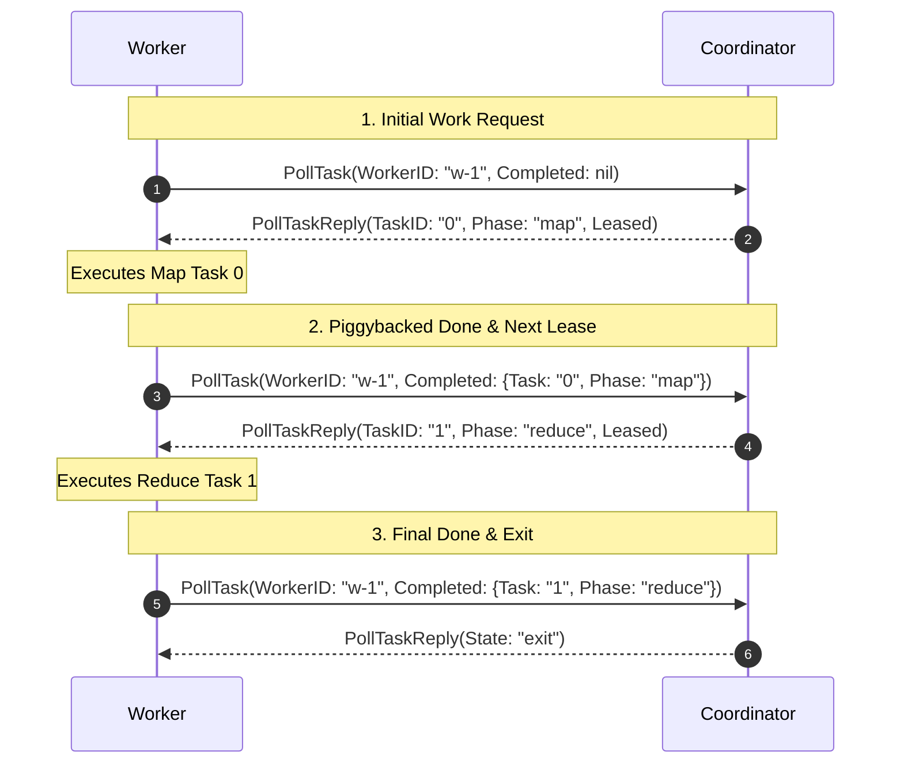
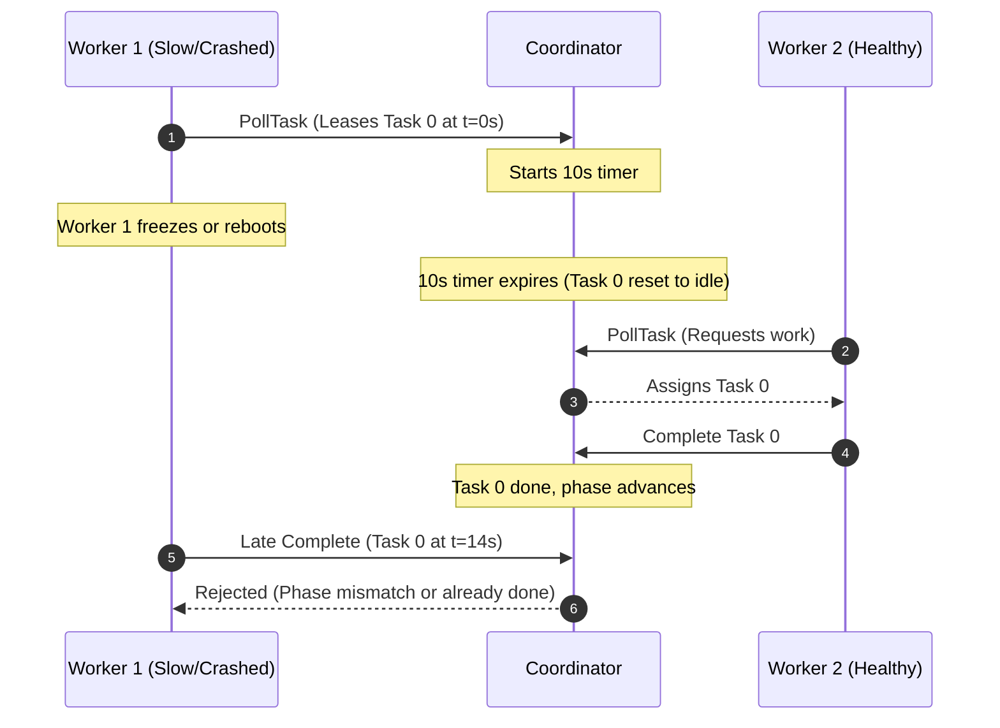

MapReduce processes massive datasets without lock contention or corruption by splitting work into two pure functions (Map and Reduce) and passing immutable partition files between workers using a time-bounded lease coordinator.

---

## Why Counting Words Across 10 Machines Breaks

Imagine you have 500 gigabytes of web server logs, and you want to count how many times every unique IP address or error message appears. 

On a single computer, this job is painfully slow. Your CPU hits 100% utilization, and your program eventually crashes when the dictionary of counts exceeds available RAM. 

The obvious instinct is to distribute the work. You spin up 10 worker servers, divide the raw log files among them, and tell each worker to parse records and update counts in a shared database or a shared central file. 

In production, this naive setup breaks down in three catastrophic ways:

1. **Write Contention**: Hundreds of worker threads attempt to increment counts for frequent keys like `GET /` or `200 OK` simultaneously. Workers spend more time stalled in line waiting for database locks than actually processing log lines.
2. **Partial Crash Corruption**: If worker 4 crashes halfway through updating 5,000 records, your database is left with dirty, half-committed state. You have no clean way to know which records succeeded and which were cut short.
3. **Straggler Paralysis**: If one machine hits a bad network cable or slow disk, the entire job sits idle waiting for that single node to finish its batch.

MapReduce eliminates all three problems by removing shared mutable state entirely. Workers never write to a shared database, never acquire distributed locks, and never talk directly to each other.

---

## The Core Intuition

MapReduce replaces shared state with two simple, pure stages: **Map** and **Reduce**.



### 1. The Map Function
A Map worker reads raw input data and emits individual key-value pairs. The function is completely pure: given the same input file, it always produces the exact same pairs.

For a word count program, parsing the string `"apple banana apple"` emits three independent items:
- `("apple", "1")`
- `("banana", "1")`
- `("apple", "1")`

### 2. The Reduce Function
A Reduce worker gathers every value generated for a specific key across the entire dataset and folds them into a single summary result.

For the key `"apple"`, the reducer receives the grouped list `("apple", ["1", "1"])` and outputs:
- `"apple 2"`

### The Routing Trick: Deterministic Hashing
How do we guarantee that every `"apple"` record generated by ten different mappers ends up on the exact same reducer without the workers coordinating? 

We use a deterministic hash function:

```text title="Routing Formula"
bucket = hash(key) % N_reduce
```

If we configure the job with two reduce buckets ($N_{reduce} = 2$), every worker evaluates the hash of `"apple"` modulo 2. Because the hash is deterministic, every worker independently sends `"apple"` to Bucket 0 and `"banana"` to Bucket 1. No central routing server is needed during the transformation.

---

## System Architecture: Coordination vs. Computation

The system cleanly separates coordinating work from executing work across three components:



### Coordinator (The Supervisor)
The Coordinator is a lightweight daemon that holds the job's state machine in memory under a single mutex. It tracks which tasks are idle, currently leased, or completed. It never touches raw data files, never parses text, and never does math.

### Worker (The Compute Engine)
Workers are autonomous worker processes running in a loop. A worker asks the coordinator for a task lease, reads the assigned files from disk, runs `mapF` or `reduceF`, writes intermediate files to disk, and reports completion. If a worker crashes, no state is lost because intermediate files are immutable and tasks can be re-run from scratch.

---

## The Task Lease Protocol: Cutting Network Overhead by 54%

Many distributed architectures use chatty protocols where workers register, pull job configurations, fetch task IDs, and send completion pings through separate network round-trips.


In our Go implementation ([github.com/uttam282005/mapreduce](https://github.com/uttam282005/mapreduce)), we collapse this entire lifecycle into a single atomic RPC endpoint: **`PollTask`**.



When a worker calls `PollTask`, it accomplishes two things at once:
1. It reports that its previous task finished successfully.
2. It requests its next task lease, receiving all required file names and bucket counts in the reply.

### Network Round-Trip Cost Comparison (20 Tasks across 4 Workers)

| Protocol Pattern | Initial Handshake | Per-Task RPCs | Exit Checks | Total Round-trips |
| :--- | :--- | :--- | :--- | :--- |
| **Legacy Chatty Protocol** | 8 calls (`Register` + `GetMeta`) | 40 calls (`GetJob` + `ReportDone`) | 4 calls (`GetJob` -> exit) | **52 calls** |
| **Collapsed Lease Protocol** | 0 calls (metadata in lease) | 20 calls (piggybacked `PollTask`) | 4 calls (`PollTask` -> exit) | **24 calls** *(54% reduction)* |

---

## A Concrete Worked Example

Let us trace a complete word count run from raw text to final output.

We configure the job with two reduce buckets ($N_{reduce} = 2$) and two input files:
- `input1.txt`: `"foo bar foo"` (Assigned as Map Task 0)
- `input2.txt`: `"foo baz"` (Assigned as Map Task 1)

Our hash function yields:
- `hash("foo") % 2 = 0` (Bucket 0)
- `hash("bar") % 2 = 1` (Bucket 1)
- `hash("baz") % 2 = 1` (Bucket 1)

### Step 1: The Map Phase
Two workers poll the coordinator and lease the map tasks. Each worker reads its file, runs `mapF`, groups pairs by bucket, and writes partitioned intermediate files named `mr-X-Y` (where `X` is the map task ID and `Y` is the reduce bucket).

| Task | Input File | Emitted Pairs | Partition `mr-X-0` (Bucket 0) | Partition `mr-X-1` (Bucket 1) |
| :--- | :--- | :--- | :--- | :--- |
| **Map 0** | `input1.txt` | `("foo",1)`, `("bar",1)`, `("foo",1)` | `[("foo",1), ("foo",1)]` | `[("bar",1)]` |
| **Map 1** | `input2.txt` | `("foo",1)`, `("baz",1)` | `[("foo",1)]` | `[("baz",1)]` |

### Step 2: The Phase Barrier
Worker 1 finishes Map Task 0 quickly and calls `PollTask` requesting more work. However, Map Task 1 is still being processed by Worker 2. 

The coordinator replies with `State: "wait"`. 

The Reduce phase cannot begin until **100% of Map tasks reach completion**. If Reducer 0 started while Map Task 1 was still running, it would only read `"foo"` entries from `mr-0-0` and miss the `"foo"` entries being generated in `mr-1-0`, creating permanently corrupted, incomplete counts.

### Step 3: The Reduce Phase
Once Worker 2 finishes Map Task 1, all map files exist on disk. The coordinator advances its internal state to `PhaseReduce`.

Each reducer gathers the partition files for its assigned bucket index across all completed map tasks:

| Reduce Task | Partition Files Ingested | Grouped Key-Values | Final Output File | Content |
| :--- | :--- | :--- | :--- | :--- |
| **Reduce 0** | `mr-0-0`, `mr-1-0` | `"foo"`: `["1", "1", "1"]` | `output/mr-out-0` | `foo 3` |
| **Reduce 1** | `mr-0-1`, `mr-1-1` | `"bar"`: `["1"]`, `"baz"`: `["1"]` | `output/mr-out-1` | `bar 1`<br>`baz 1` |

### Step 4: The Atomic Commit Pattern
What happens if a worker crashes midway through writing `output/mr-out-0`?

If the worker wrote directly to `output/mr-out-0`, a crash would leave a half-written file. When the task was reassigned, the second worker would overwrite or corrupt the partial file.

To prevent this, workers write to a temporary file: `output/mr-out-0.tmp`. Only after the entire file is flushed to disk does the worker execute an atomic filesystem rename:

```go title="mr/worker.go"
// Atomically commit the output file
err := os.Rename(tempFileName, finalFileName)
```

Under POSIX systems, `os.Rename` is atomic. Other processes either observe the old file or the complete new file; an incomplete write is physically impossible to observe.

---

## Fault Tolerance: Handling Crashes and Stragglers

In distributed systems, worker failures are a guarantee, not an anomaly. Instead of using complex ping-pong heartbeats, the coordinator guards every assignment with a **10-second lease**.



### Scenario A: Worker Crash
Worker 1 takes Map Task 0 but experiences a machine reboot. Because the coordinator does not receive a completion report within 10 seconds, it resets Map Task 0 back to idle. The very next worker that polls gets assigned Map Task 0, and the job proceeds without human intervention.

### Scenario B: The Zombie Straggler
Worker 1 did not crash; it just paused for 12 seconds due to an aggressive operating system paging freeze. 

By the time Worker 1 unfreezes and calls `PollTask` to report Map Task 0, Worker 2 has already leased, re-computed, and finished Map Task 0. The job has already transitioned to `PhaseReduce`.

When Worker 1's late RPC arrives, the coordinator inspects the phase. Because the task report belongs to a previous phase, the coordinator discards the completion report. The zombie worker's delayed update is safely rejected, preserving strict consistency.

---

## Trade-offs and Limitations

MapReduce is intentionally simple, but that simplicity involves real architectural compromises:

| Advantage | Trade-off / Cost |
| :--- | :--- |
| **Zero Lock Contention**: Workers never share memory or write to shared tables. | **Disk I/O Overhead**: Writing and re-reading intermediate `mr-X-Y` files creates high disk throughput demands. |
| **Deterministic Crash Recovery**: Any task can fail and replay cleanly from input files. | **Phase Barrier Delays**: One single slow mapper prevents all reducers from starting. |
| **Minimal Central State**: The coordinator only stores task status integers and timestamps. | **Batch Only**: Not suited for streaming or low-latency event processing. |

Frameworks like Apache Spark later evolved this model by keeping intermediate partitions in memory rather than spilling every phase to disk, while retaining the core MapReduce abstraction.

---

## References and Source Code

- **Implementation**: [uttam282005/mapreduce](https://github.com/uttam282005/mapreduce) on GitHub. Full Go source code featuring the single-round-trip lease protocol, in-memory scheduler, and atomic file commit semantics.
- **MIT 6.824 / 6.5840 (Lab 1: MapReduce)**: [MIT Distributed Systems Course](https://pdos.csail.mit.edu/6.824/labs/lab-mr.html). The course lab that inspired this implementation.
- **Original Paper**: [MapReduce: Simplified Data Processing on Large Clusters](https://research.google/pubs/pub62/) (Jeffrey Dean and Sanjay Ghemawat, Google, 2004).
